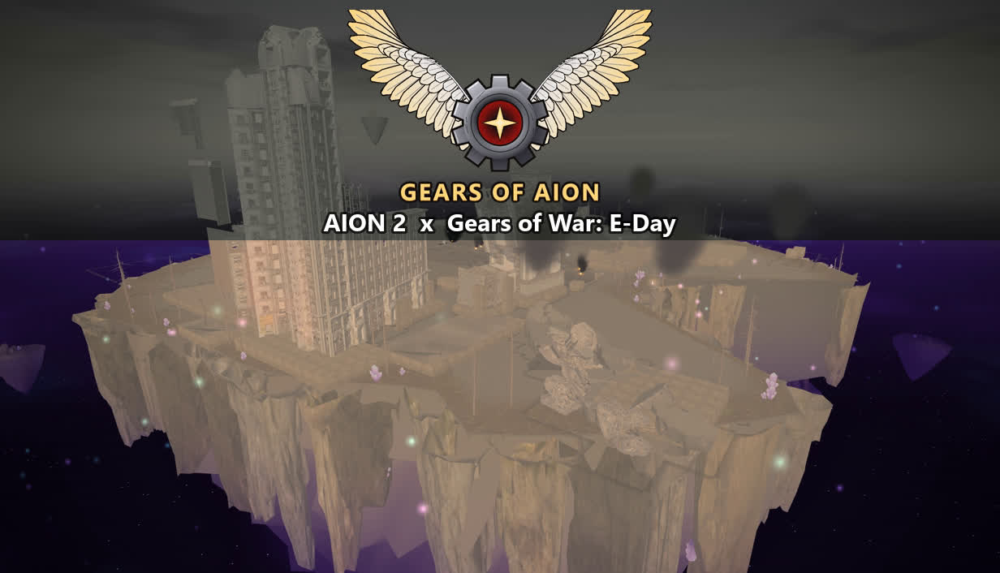
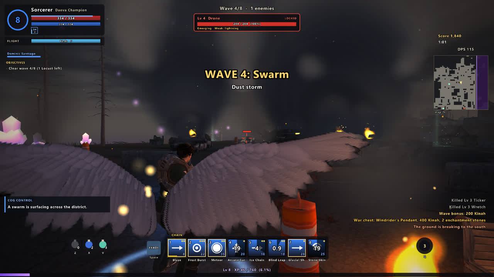
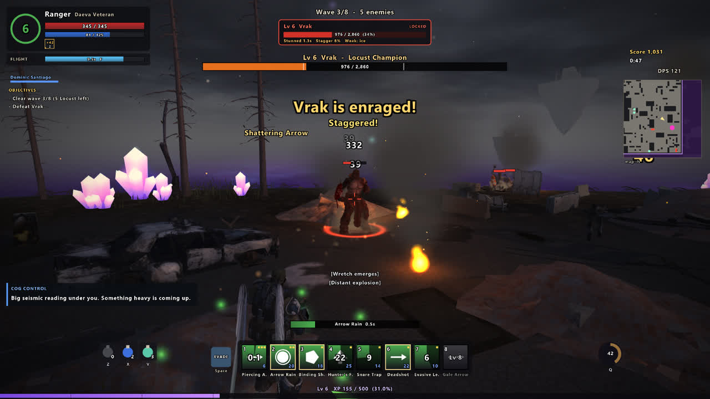
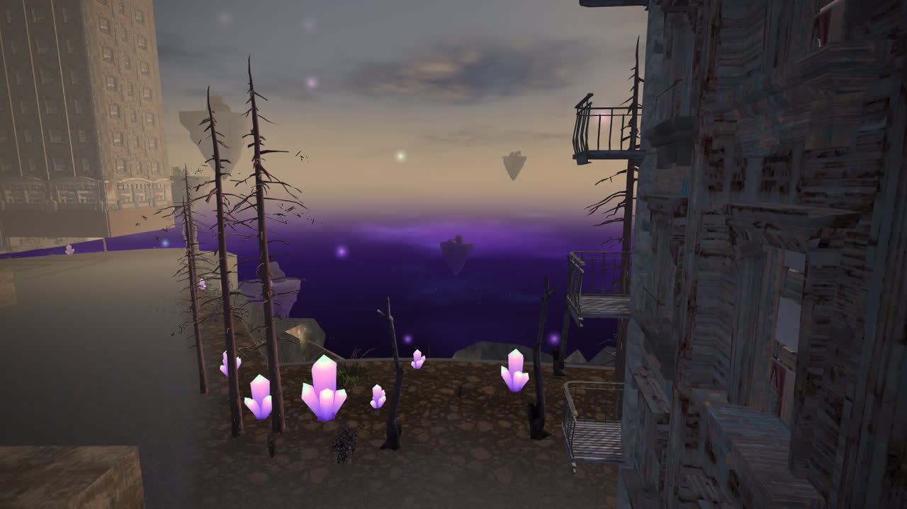
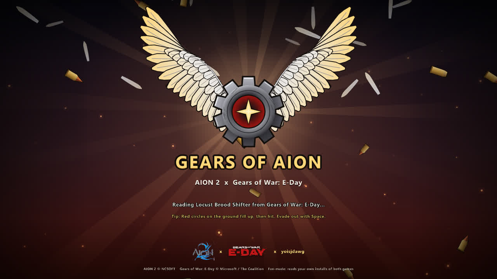

# Gears of Aion

**AION 2's Daevas land in Gears of War: E-Day's Siege.** Pick one of eight AION-style classes, each played as a Gears hero, and hold the streets of Sera against the Locust with AION skills, chains, crowd control and Daeva wings. The city, the Locust, the heroes, their animations, the music and the sounds are all read from your own Gears of War: E-Day install. From AION 2 the game reads its logo (cut from its splash art) at start; everything AION in play (the classes, skills, wings and the Abyss) is original AION-style design, made for this game.

| | |
|---|---|
|  |  |
|  |  |

**Get it:** play it through [Melty](https://melty.gg/m/gears-of-aion) (one click, needs both games installed), or download `GearsOfAion-<version>-win64.zip` from this repository's Releases and run `GearsOfAion.exe`.

Created by **yoisjdawg**. Free to remix under GPL-3.0-or-later (see Credits and license, and `REMIX.md`).

## What you get
- **Three Siege districts**, read from your install: Downtown, Industrial (unlocks at wave 3) and Historic (unlocks with a campaign clear). They're dressed with burnt-out wrecks and buses, sandbags, barbed wire, barricades and rubble you can blow apart.
- **The Abyss:** your district was torn out of Sera and floats in AION's Abyss. Its streets end at a ragged rim of Gears cliffs, rocky soil, pines and deadwood and glowing violet crystals; below and around it, a starry violet void with drifting islands, a ruined citadel, the glow of the Abyss core, aether motes rising and chunks of the rim breaking away. Locust flyers rise out of the void, elites come through aether rifts, and aether shards wait on the rooftops for whoever flies up to them.
- **A living city:**
  - a shader sky with clouds and sun shafts, with the time of day moving across the waves;
  - weather: rain with puddles, razorhail, dust storms, and thunderstorms with lightning that strikes the street;
  - night, with street lamps and burning buildings;
  - searchlights, King Ravens overhead, and firefights a few streets over.
- **8 AION classes**, each a Gears hero (other heroes unlock as looks). Each class has 8 skills with chains and elements, plus a class mechanic:
  - Gladiator: Wrath and Berserk Stance.
  - Templar: taunts and Shield Stance.
  - Assassin: runes, poison and backstabs.
  - Ranger: focus and traps.
  - Sorcerer: Flame Cage and Delayed Blast.
  - Spiritmaster: four spirits.
  - Cleric: Sanctuary and resurrection.
  - Chanter: mantras and combo strikes.
- **AION combat:**
  - cast bars;
  - crowd control: stun, knockback, knockdown, airborne, root, slow, silence, disarm and taunt;
  - weaknesses and resistances;
  - combos, counters after a dodge, and block/parry/resist;
  - headshots, interrupts, wall slams, and executions on downed Locust;
  - Stigmas at levels 5, 10 and 15;
  - an ultimate with Daeva Transformation, and Ascension at level 10;
  - levels to 30, with prestige.
- **Flight:** great feathered Daeva wings after AION 2's (Elyos white or Asmodian dark, and a size setting), folded on your back on the ground and sweeping open to fly. Gliding, wind streams, an air dash, a diving strike, a wingbeat that follows your climb, and a feather trail when you boost. Fly onto rooftops: the high ground gives +15% damage.
- **Gears moves:** vault low cover, climb onto crates, ledges and wrecks, catch a ledge you fall short of, roll out of long drops, walk up stairs and over rubble, and stand behind cover to take less damage. Vault a shopfront's sill to fight from inside the shops.
- **The Locust:**
  - Wretches (they climb after you), Drones (they take cover), Boomers, Tickers and Reavers;
  - snipers, shotgunners, grenadiers, Flooders, Spore Matrons that heal, and Seeders with their Nemacysts;
  - Brood Shifters, Scorched Rushers, Siegebreakers, and elites with rally banners;
  - bosses: Vrak, the Corpser, Vrak the Scorched and the Brumak, with phases, telegraphed attacks and enrage.
- **Modes:**
  - an eight-wave campaign with radio and an ending;
  - Endless Horde, Siege Defence (protect the COG ammo van), Rescue (keep a stranded COG squad alive until the King Raven comes), Boss Rush, Time Attack and a Daily Challenge (with the Abyss Storm among its modifiers);
  - Custom Waves (build your own), the Practice Range and a Tutorial;
  - Hardcore for any mode, and local leaderboards.
- **Loot and progression:**
  - AION grades from Common to Mythic, eight gear slots, enchanting to +15, manastones and sets;
  - a vendor between waves, and crafting at the COG supply station;
  - daily and weekly missions and bounties from the Quartermaster, and COG reputation;
  - achievements, titles, Abyss ranks, a codex and lore pages.
- **A COG squadmate** fights beside you (you can turn it off).
- **Sound from your install:** Gears music, ambience, voices, footsteps and creature cries, with captions.
- **Options:** key and gamepad rebinding, difficulty, graphics presets, colour grades, colour-blind filters (with amber Locust markers), subtitle size, rumble, wing size and colour, game speed, auto-evade, mouse-only controls, a simple hotbar, camera options and more.
- **AION 2 x Gears of War: E-Day x yoisjdawg:** both games' logos, read from your installs, on the splash, loading screen and credits.
- **Steady on an ordinary PC:** about 2-4 GB of memory, one copy at a time, and if it ever crashes the next start says so and offers a safe mode.

Solo only.

## What you need
- **Gears of War: E-Day** (PC, Xbox app / Game Pass). This program reads its map, characters, textures, animations, music and sounds from it. The first start of each district takes a few minutes while its map cells are read. After that, a district builds in seconds.
- **AION 2** (Steam). This program checks your install and reads its logo from the splash art.

Neither game is modified, and neither is started. Gears of Aion is a separate program that reads your installed copies of both games. Nothing from either game is copied into this package.

## Where it keeps things
Everything lives in `%LOCALAPPDATA%\GearsOfAion`:
- `profile.json`: your bag, missions and records;
- `settings.json`;
- `city-cache` and `sound-cache`: built from your installs, on your PC only;
- `logs`;
- `replays`: your last 10 runs. Press **R** on the title screen to watch the last one, or run `GearsOfAion.exe --replay <file>`;
- `mods`: sheet mods (see `REMIX.md`).

**Uninstalling:** Options > Delete all saved data clears the profile, settings and caches. Delete that folder to remove the rest.

## Controls
Press **F1** in game for the full card. Every keyboard key can be changed in Options > Key bindings.

| Key | Action |
|---|---|
| WASD, mouse | Move and aim (the wheel zooms) |
| Left mouse | Basic attack (auto-attack keeps going on a locked target) |
| 1-8 | Skills (press again for a lit-up chain) |
| Q | Ultimate (Daeva Transformation) |
| Tab | Lock or switch target |
| Space | Evasion roll (into low cover: vault over or climb up; in the air: air dash) |
| F / R | Fly or land / dive strike from the air |
| Shift | Run (in the air: boost) |
| Z / X / V | Life potion / mana potion / wind serum |
| E | Execute a downed Locust; talk at the supply station |
| G / C / K | Stance / command spirits / choose a Stigma |
| I | Bag, vendor, crafting, missions, codex |
| B | Sandbags (between waves) |
| N / L | Map (and spawn-point editor) / combat log |
| Enter | Start the next wave now |
| Esc or P | Pause (options, bag, feedback, retry) |
| F3 / F8 / F10 / F11 / F12 | Performance / problems / photo mode / borderless window / screenshot |
| F9 | Mute or unmute |

Gamepad:
- left stick moves, right stick looks;
- RT attacks, A sprints, B evades, Y flies, X executes;
- the D-pad casts skills 1-4, and LT + D-pad casts skills 5-8;
- RS locks a target, LB/RB drink potions, and LT + RS fires the ultimate.

## How it works
- **Gears of War: E-Day** is an Unreal Engine 5.6 game with an anti-cheat launcher. The mashup never touches the running game. Instead, it opens the game's IoStore archives read-only with [CUE4Parse](https://github.com/FabianFG/CUE4Parse):
  - Oodle compression is decoded by [ooz](https://github.com/powzix/ooz).
  - Mesh LOD buffers, skeletons and ACL-compressed animations are found without the game's type map.
  - Animations are decoded with ACL and baked onto each character's own skeleton by bone name.
- **The map:**
  - Siege Downtown's World Partition cells (`systems.city.cells`, base cells plus the battle-damaged `d175F5ED0` data layer) hold FastGeo containers.
  - Their static mesh components and instances (Gears stores each instance as a 3x3 matrix plus a translation) give every placed mesh and its transform.
  - Those meshes are baked into per-texture chunks around `systems.city.center`. Street-level pieces become colliders, and a flow field over them guides the Locust.
- **AION 2's** game data is encrypted, and the mashup does not decrypt it. The fighting system here is our own AION-style design, and only AION 2's loose `Splash.bmp` is read.
- **The design** lives in `sheets/*.json`. `python tools/sheets.py generate` runs a preflight over every row and column, then generates `src/Daevas.Game/Generated/Sheets.g.cs`.

## Build
- .NET 10 SDK: `dotnet publish src/Daevas.Game -c Release -r win-x64 --self-contained`.
- CUE4Parse at commit `18430ca4692a02f531d2e2216f9f5bdac0400366`, with `third_party/cue4parse.patch` applied, checked out at `../.tools/CUE4Parse`.
- `native/ooz.dll` is built from `native/ooz` and `native/ooz_export.cpp` with clang (llvm-mingw).
- `native/CUE4Parse-Natives.dll` is CUE4Parse-Natives built with ACL only: `clang++ -O2 -shared -std=c++17 -DWITH_ACL -DWIN_EXPORT ACL/ACL.cpp Features.cpp`.
- `native/vgmstream/vgmstream-cli.exe` is vgmstream r2117 built with Vorbis only: `make vgmstream-cli VGM_X64=1 VGM_MPEG=0 VGM_G719=0 VGM_FFMPEG=0 VGM_ATRAC9=0 VGM_CELT=0 VGM_SPEEX=0 VGM_G7221=0` (llvm-mingw clang). It ships with vgmstream's x64 `libvorbis.dll`.

Run `GearsOfAion.exe --gears "<Gears folder>" --aion "<AION2 folder>"`. Without arguments, it looks in `X:\XboxGames` and in your Steam libraries.

## Credits and license
- **Gears of Aion** by yoisjdawg. Licensed GPL-3.0-or-later (`LICENSE`): you're free to use it, change it and share your remix. Keep the credit and the license.
- **AION 2** is © NCSOFT. **Gears of War: E-Day** is © Microsoft / The Coalition. This is an unofficial fan mashup, not affiliated with or endorsed by either. Class names follow AION 2. Every skill, number and arena layout in this package is original, and so are the synthesized skill sounds. The Gears characters, guns, set pieces, animations and recordings stay in your install and are read while you play. None of them are in this package.
- Third-party software is listed in `THIRD_PARTY_NOTICES.md`.
